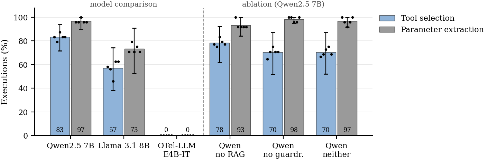
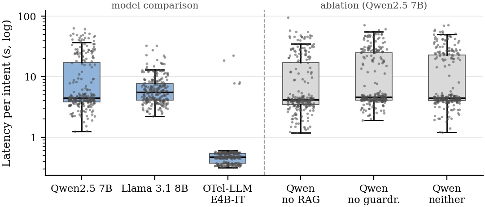
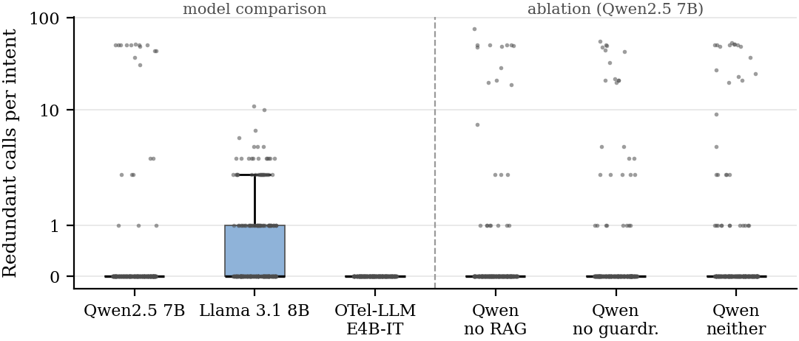
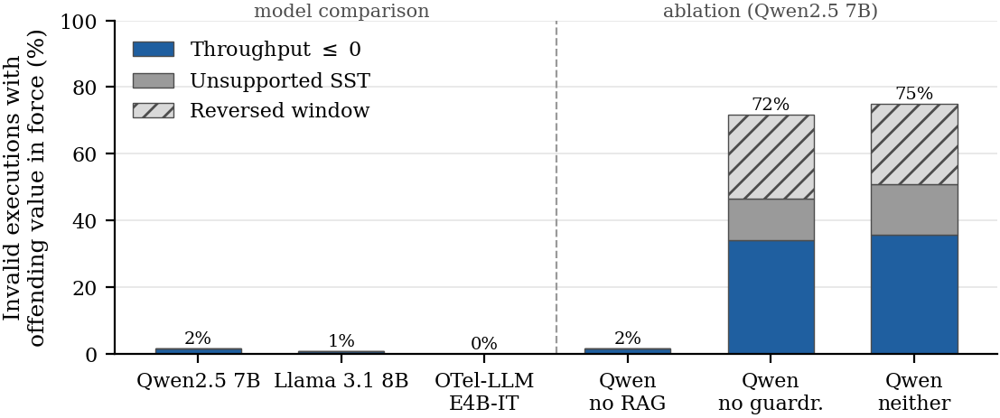
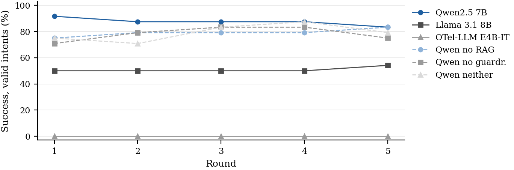
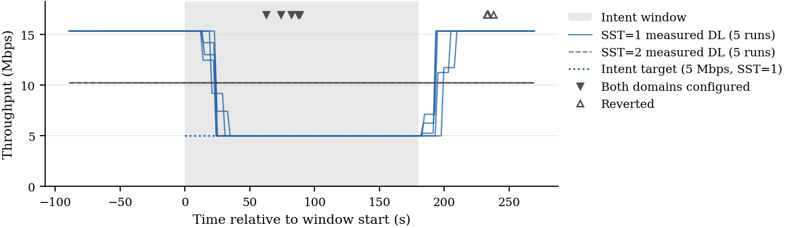

# MINAS - Multi-Agent Intent-Driven Network Analytics and Slicing

Undergraduate thesis (TCC II), Computer Science, UNISINOS
Advisor: Prof. Dr. Cristiano Bonato Both

A multi-agent system that turns operator intents written in natural language into the configuration of 5G network slices, in the core and in the radio access. An orchestrator agent decomposes each intent into directives for a core agent (CN-NSSMF) and a RAN agent (RAN-NSSMF), coordinated over MCP. Deterministic guardrails validate every tool call, retrieval (RAG) grounds the interpretation in excerpts of the 3GPP specifications, an NWDAF predicts the load of each slice, and deterministic code (not the model) activates and reverts intents that have a time window.

**Status (22/11/2026):**
- evaluation without enforcement complete: benchmark in 5 rounds, monolithic baseline, and window, fault, and UC1 probes (see [Benchmark and experiments](#benchmark-and-experiments));
- real enforcement implemented (`ENFORCEMENT_MODE=real`) and evaluated in an emulated testbed (real UPF, stand-in gNB) and in the laboratory (Open5GS, OCUDU/srsRAN gNB with a commercial RU, two smartphones). The laboratory runs completed the lifecycle in both domains. The effect of the PRB reservation on a loaded cell was not measured.

The **16 benchmark intents** and their ground truth are in [`agents/benchmark/intents.json`](agents/benchmark/intents.json) and listed in [Benchmark intents](#benchmark-intents).

---

## Architecture

```
Operator (natural language)
        │  POST /intent
        ▼
┌──────────────────────┐      RAG (3GPP excerpts)
│  Orchestrator agent  │  ←   LLM + ReAct + tool calling (MCP client)
│ + window scheduler   │
└──────┬───────────────┘
       │ directives over MCP (streamable HTTP)
  ┌────┴─────────┐
  ▼              ▼
CN-NSSMF       RAN-NSSMF      ← MCP servers; each directive runs its own ReAct loop
(core agent)   (RAN agent)
  │  │  NWDAF (RandomForest, Nnwdaf_AnalyticsInfo)
  │  │
  │  └─ ENFORCEMENT_MODE=real ─┐
  ▼                            ▼
upf-shaper (tc at the UPF)  gnb_slicer (sched_cfg + gNB restart)
Open5GS (Docker)            OCUDU / srsRAN Project (lab host) ── physical RU
```

The orchestrator agent and the domain agents are coordinated over **MCP** (Model Context Protocol). Each domain agent is an MCP server that exposes its directives as tools, and the orchestrator agent, as a client, discovers them dynamically. The NWDAF uses HTTP, modelled on the 3GPP `Nnwdaf_AnalyticsInfo` interface (TS 23.288 / TS 29.520).

**Two slices:**
- `SST=1` (eMBB, DNN `internet`, UEs in 10.45.0.0/16, TUN `ogstun`) - streaming / UC2
- `SST=2` (URLLC, DNN `slice2`, UEs in 10.46.0.0/16, TUN `ogstun2`) - mission critical / UC1

---

## Use cases

### UC1 - Predictive resource adjustment (SST=2)
An intent without a window ("keep 6 Mbps guaranteed on the URLLC slice"). The CN-NSSMF monitor queries the NWDAF every 30 s with a 60 s horizon. If the predicted demand exceeds the guarantee in force by more than 10 %, it notifies the orchestrator agent, which raises the guarantee in both domains to prediction × 1.1, or marks the intent `degraded` if the RAN cannot fit it.

### UC2 - Scheduled QoS policy (SST=1)
An intent with a window ("20 Mbps on the streaming slice from 18:00 to 22:00"). The orchestrator agent records the intent as `scheduled`. When the window opens, the window scheduler sends both directives (the CN-NSSMF configures the QoS policy and the RAN-NSSMF reserves PRBs), and when it closes, it reverts both. Activation and reversion are done by code, not by the model.

---

## Repository layout

```
tcc_minas/
├── docker-compose.yml          # Full stack (Open5GS + monitoring + database + agents)
├── docker-compose.lab.yml      # Lab overlay: GTP-U over the bridge, UE NAT,
│                               #   real collector, upf-shaper, ENFORCEMENT_MODE=real
├── requirements.txt            # Python dependencies of the agents
├── env.example                 # Environment variables (copy to .env)
│
├── open5gs/                    # 5G core configuration
│   ├── amf.yaml                # SST=1 + SST=2, TAC=1, PLMN 00101
│   ├── smf.yaml                # DNN internet (10.45.0.0/16) + slice2 (10.46.0.0/16)
│   ├── upf.yaml                # ogstun + ogstun2, advertise 127.0.0.1
│   ├── upf.lab.yaml            # same, advertise 10.11.0.22 (gNB on the host, via the bridge)
│   ├── amf.lab.yaml            # lab: S-NSSAI with SD (SST 1/SD 111111, SST 2/SD 222222), as the lab gNB
│   ├── nssf.lab.yaml           # lab: same S-NSSAI with SD
│   └── nrf/scp/ausf/udm/udr/pcf/nssf/bsf.yaml
│
├── srsran/
│   └── gnb.yaml                # gNB skeleton; in the lab the template is gnb.lab.yaml (not versioned),
│                               #   derived from the laboratory configuration
│
├── agents/
│   ├── schema.sql              # PostgreSQL schema
│   ├── migrations/             # ALTERs for existing databases (schema.sql only runs on a new volume)
│   ├── Dockerfile              # single image for the agents (minas-agent:local; build context = repo root)
│   ├── db.py                   # shared PostgreSQL connection (thread-safe, autocommit)
│   ├── timeutil.py             # operator time zone (MINAS_TZ): "now" in the prompt, naive times = local
│   ├── react.py                # Ollama client + shared ReAct loop
│   ├── guardrails.py           # deterministic parameter validation (before dispatch, all agents)
│   ├── mcp_common.py           # MCP client helpers (list_remote_tools / call_remote_tool)
│   ├── enforcement.py          # real enforcement client (push_core -> upf-shaper, push_ran -> gnb_slicer)
│   ├── enforcers/
│   │   ├── upf_shaper.py       # UPF sidecar: per-slice DL ceiling with tc tbf (port 9300)
│   │   ├── gnb_slicer.py       # on the gNB host: per-slice min_prb_policy_ratio + restart (port 8010)
│   │   └── Dockerfile          # upf-shaper image
│   ├── orchestrator/
│   │   ├── main.py             # HTTP (POST /intent, POST /event) + CLI + RAG + system prompt; MCP client
│   │   ├── tools.py            # 3 local tools + MCP discovery + dedup + scheduling
│   │   ├── scheduler.py        # windows (UC2): activates, reverts, and cleans up failed intents with leftovers
│   │   └── sla_monitor.py      # samples the SLA of intents in force -> sla_samples / events
│   ├── cn-nssmf/
│   │   ├── main.py             # MCP server :8001/mcp: apply_qos/revert_qos/query_nwdaf/check_sla
│   │   ├── tools.py            # 5 internal tools (ReAct) + dispatcher
│   │   ├── monitor.py          # proactive UC1: queries the NWDAF and notifies the orchestrator (POST /event)
│   │   └── nwdaf_client.py     # NWDAF client (TS 23.288); falls back to a mock if it is down
│   ├── ran-nssmf/
│   │   ├── main.py             # MCP server :8002/mcp: apply_resources/revert_resources/check_sla
│   │   └── tools.py            # 5 internal tools (ReAct) + dispatcher + admission control
│   ├── monolithic/
│   │   └── main.py             # baseline: a single ReAct agent with the 13 tools (:8010)
│   ├── nwdaf/
│   │   ├── main.py             # Flask POST /analytics; real RandomForest for SLICE_LOAD_LEVEL
│   │   ├── dataset.py          # shared lag windows (service and RQ4)
│   │   └── benchmark_rq4.py    # RF vs GBM vs LSTM (+ baselines) offline over core_kpis (RQ4)
│   ├── rag/
│   │   ├── corpus.py           # 35 curated excerpts (TS 23.501/23.288/28.312/38.300/28.552 + ReAct/MCP)
│   │   └── retriever.py        # bge-small-en-v1.5 embeddings; top 3 with similarity >= 0.35
│   ├── benchmark/              # benchmark intents, probes, baseline, and figures (see below)
│   └── collector/              # core_kpis + ran_kpis sampler (prometheus | synthetic | o1 | mock)
│       ├── main.py             # collection loop -> INSERT core_kpis / ran_kpis
│       ├── synth.py            # synthetic traffic with temporal structure (daily + AR(1) + bursts)
│       ├── backfill_synthetic.py # generates days of synthetic history in a dedicated database
│       └── o1_client.py        # stub of the gNB O1/NETCONF interface
│
├── scripts/
│   ├── provision.js            # registers UE1 (SST=1+2) and UE2 (SST=2) in MongoDB
│   ├── provision.lab.js        # same, with the lab SD; real SIMs come from sims.lab.js
│   ├── sims.lab.example.js     # template of sims.lab.js (real IMSI/K/OPc, NOT versioned)
│   ├── lab_install.sh          # setup of the lab server (packages, .env, Ollama, images)
│   ├── ue_traffic.py           # TCP DL traffic to the UEs through the phone browser + per-second log
│   ├── udp_load.py             # UDP DL load sent from inside the UPF namespace (cell saturation)
│   ├── inspect.js              # queries a subscriber in MongoDB
│   ├── lab_preflight.sh        # lab host checks BEFORE starting (SCTP, ports, subnets, Ollama, CPU, NTP)
│   ├── lab_smoke.sh            # smoke test AFTER starting (containers, health, enforcement, Prometheus, KPIs)
│   ├── lab_collect.sh          # saves everything from one experiment to lab-data/<ts>_<label>/
│   └── gnb_restart.sh          # restarts the gNB from the configuration rendered by gnb_slicer
│
└── monitoring/
    ├── prometheus.yml          # scrape: AMF, SMF, UPF (:9090) + upf-netdev (:9100, TUN per slice)
    └── grafana/provisioning/datasources/prometheus.yml
```

Not versioned (`.gitignore`): `tcc1/`, `tcc2/` (thesis text), `agents/benchmark/results/`, `lab-data/`, and the working notes at the repository root.

---

## Docker services

| Container | Image | IP | Exposed port |
|---|---|---|---|
| mongodb | mongo:4.4 | 10.11.0.2 | - |
| nrf / ausf / udm / udr / pcf / bsf / nssf / scp | gradiant/open5gs:2.6.4 | 10.11.0.10–17 | - |
| amf | gradiant/open5gs:2.6.4 | 10.11.0.20 | **38412/sctp** |
| smf | gradiant/open5gs:2.6.4 | 10.11.0.21 | - |
| upf | gradiant/open5gs:2.6.4 | 10.11.0.22 | **2152/udp** |
| upf-netdev | prom/node-exporter:v1.8.2 | (upf network) | - |
| webui | gradiant/open5gs-webui:2.6.4 | 10.11.0.30 | 3000 |
| postgres | postgres:16-alpine | 10.11.0.40 | 5432 |
| prometheus | prom/prometheus:v2.53.0 | 10.11.0.50 | 9090 |
| grafana | grafana/grafana:11.1.0 | 10.11.0.51 | 3001 |
| orchestrator | build `agents/Dockerfile` | 10.11.0.55 | 8000 |
| cn-nssmf | build `agents/Dockerfile` | 10.11.0.60 | 8001 |
| collector | build `agents/Dockerfile` | 10.11.0.61 | - |
| ran-nssmf | build `agents/Dockerfile` | 10.11.0.62 | 8002 |
| nwdaf | build `agents/Dockerfile` | 10.11.0.63 | 8080 |

Only with the `docker-compose.lab.yml` overlay:

| Container | What it is | IP / port |
|---|---|---|
| upf-shaper | sidecar in the `upf` network (`NET_ADMIN`), `agents/enforcers/upf_shaper.py` | upf:9300 |

`gnb_slicer.py` is not a container. It runs natively on the gNB host (port 8010), because the gNB runs outside Docker.

---

## Getting started

### Requirements
- Docker and Docker Compose
- Ollama running on the host (or on another machine, via `OLLAMA_URL`) with `qwen2.5:7b`
- Python 3.11+ on the host for the benchmark scripts

### Benchmark mode (no radio, mock enforcement)

```bash
git clone https://github.com/Gabrrrrla/tcc_minas && cd tcc_minas
cp env.example .env          # OLLAMA_URL, MINAS_MODEL, MINAS_TZ
docker compose up -d
docker compose logs -f amf        # AMF initialize...OK
docker compose logs provision     # Subscriber ...001 provisioned
curl localhost:8000/health
```

Without a gNB, set `CORE_SOURCE=synthetic` and `RAN_SOURCE=synthetic` in `.env` (the compose default, `prometheus`, only has data when UEs generate traffic). All simulated measurements of the thesis were made this way. With `ENFORCEMENT_MODE` unset (= `mock`), the agents decide, validate, and persist, but nothing is written to the network.

| Interface | URL | Credentials |
|---|---|---|
| Open5GS WebUI | http://localhost:3000 | admin / 1423 |
| Grafana | http://localhost:3001 | admin / minas |
| Prometheus | http://localhost:9090 | - |

### Lab mode (real gNB and UEs, real enforcement)

**Setup on the lab server (once, before the experiments).** It starts nothing and does not touch the lab gNB or core:

```bash
git clone https://github.com/Gabrrrrla/tcc_minas && cd tcc_minas
bash scripts/lab_install.sh     # packages, SCTP, lab .env, Ollama + qwen2.5:7b, Docker images
nano scripts/sims.lab.js        # IMSI/K/OPc of the 2 SIM cards (file outside git)
bash scripts/lab_preflight.sh   # checks the host
```

`lab_install.sh` ends with a summary of failures and warnings, and it can be run again after fixing them.

The gNB runs **outside Docker** (DPDK), on the same physical server, and talks to the core directly over the `minas-net` bridge, without NAT:

```
gNB (host) ──N2/SCTP──> AMF 10.11.0.20:38412      (gNB bind: 10.11.0.1, bridge gateway)
gNB (host) <─N3/GTP-U─> UPF 10.11.0.22:2152       (open5gs/upf.lab.yaml advertises this IP)
```

Steps:

1. `bash scripts/lab_preflight.sh`: checks the host (SCTP, ports, subnets, Ollama, CPU isolation, NTP).
2. gNB template (`srsran/gnb.lab.yaml`, not versioned) derived from the laboratory configuration, with `amf.addr 10.11.0.20`, `bind_addr 10.11.0.1`, N3 also on `10.11.0.1`, and PLMN/TAC/S-NSSAI (with SD) equal to `open5gs/amf.lab.yaml`. Real IMSI/K/OPc in `scripts/sims.lab.js` (not versioned, template in `scripts/sims.lab.example.js`), read by `provision.lab.js`.
3. On the gNB host, start `gnb_slicer.py` (see [Real enforcement](#real-enforcement)).
4. `.env`: `ENFORCEMENT_MODE=real` (overlay default), `GNB_SLICER_URL`, `ENFORCEMENT_TIMEOUT_S` longer than the gNB restart, and the cell's `RAN_PRB_TOTAL`/`RAN_MBPS_PER_PRB` (in the lab: 100 MHz, SCS 30 kHz = 273 PRB, measured 2.67 Mbps/PRB).
5. Start:
   ```bash
   docker compose build
   docker compose -f docker-compose.yml -f docker-compose.lab.yml build upf-shaper
   docker compose -f docker-compose.yml -f docker-compose.lab.yml up -d
   ```
6. gNB → NG Setup in the AMF log → UEs → sessions on both slices. Traffic: nothing is installed on the phones. `ue_traffic.py` runs on the server, listens on `10.11.0.1:8090` (the MINAS bridge, never the public IP), and each phone opens its page in the browser (`http://10.11.0.1:8090/A`, `/B`). The page pulls an endless TCP download at the requested rate, discards the bytes, and reports every second how much it received. The log uses the server clock, with the bytes sent, received by each phone, and the throughput of each slice at the UPF:
   ```bash
   python3 scripts/ue_traffic.py --find                                    # UE IPs (SMF log)
   python3 scripts/ue_traffic.py --ue A --ue B --duration 900 --label e2-rep1
   ```
   The host firewall must accept TCP from `10.11.0.0/24` on port 8090 (the same rule as the slicer's `:8010`). The script tests this from inside the UPF at start-up.
7. `SHAPER_WRITE_TEST=1 bash scripts/lab_smoke.sh` → 0 FAIL.
8. After each experiment: `bash scripts/lab_collect.sh <label> [minutes]`.

The LLM must not compete for CPU with the gNB. Run it on a GPU or on another machine (`OLLAMA_URL`). Without `isolcpus` on the gNB cores, pin the containers to the other cores after starting: `docker update --cpuset-cpus <free cores> $(docker ps -q)`.

---

## Agents

The agents use **Ollama** as a local inference server, without external APIs.

```bash
ollama serve
ollama pull qwen2.5:7b     # MINAS default model
```

### Model choice

The model is selected by `MINAS_MODEL`. The benchmark (5 rounds, 240 executions per condition) compared three models of up to 8 B parameters:

| Model | Valid intents fulfilled | Note |
|---|---|---|
| `qwen2.5:7b` | 88 % (77 % when the core GBR is also checked) | the only one that drove the loop in both domains; **default** |
| `llama3.1:8b` | 51 % | completes the windowed intents, almost never the UC1 ones |
| `otel-llm-e4b-it` | 0 % | telecom-specialized; no tool call in 240 executions |

**OTel-LLM-E4B-IT.** The [OTel-LLM](https://huggingface.co/collections/farbodtavakkoli/otel-llm) series is fine-tuned on 3GPP/O-RAN/ETSI/ITU specifications in a question + retrieved context + answer format. Without RAG, the model abstained ("Answer not found in the retrieved context"). With RAG, it wrote complete invented answers, still without calling tools. Its model card states that the training has no tool-calling examples. To reproduce, the models come as PyTorch `.bin` files and must be converted to GGUF (check first for ready quantizations in `inference/ollama` in the OTel repository):

```bash
huggingface-cli download farbodtavakkoli/OTel-LLM-E4B-IT --local-dir otel-e4b   # ~31.5 GB
git clone https://github.com/ggml-org/llama.cpp && pip install -r llama.cpp/requirements.txt
python llama.cpp/convert_hf_to_gguf.py otel-e4b --outfile otel-e4b-f16.gguf --outtype f16
./llama-quantize otel-e4b-f16.gguf otel-e4b-q4_k_m.gguf Q4_K_M    # binary from a llama.cpp release
printf 'FROM ./otel-e4b-q4_k_m.gguf\n' | ollama create otel-llm-e4b-it -f -
```

### Orchestrator agent (`agents/orchestrator/`)

Receives the intent and drives the ReAct loop. Service mode (`python main.py`, port 8000) or CLI (`python main.py "<intent>"`, without the background threads).

```bash
curl -X POST localhost:8000/intent -H 'content-type: application/json' \
  -d '{"intent": "Guarantee 20 Mbps on the streaming slice (SST=1) from 18:00 to 22:00 tomorrow."}'
```

**Tools.** Local: `record_intent`, `get_sla_status`, `update_intent_status`. Domain tools, discovered over MCP and prefixed with the owner agent: `cn_nssmf_apply_qos` / `cn_nssmf_revert_qos` / `cn_nssmf_query_nwdaf` / `cn_nssmf_check_sla` (`http://cn-nssmf:8001`) and `ran_nssmf_apply_resources` / `ran_nssmf_revert_resources` / `ran_nssmf_check_sla` (`http://ran-nssmf:8002`).

**Deterministic rules:**
- *Date and time zone:* every intent reaches the LLM preceded by the current date and time in `MINAS_TZ` (default `America/Sao_Paulo`). A time without a zone is read as local.
- *Scheduling:* an intent whose window starts in the future (more than `ACTIVATION_GRACE_SECONDS`, 60 s) is recorded as `scheduled`, and `*_apply_*` calls for it are blocked in code.
- *Final status:* comes from the structured statuses of the domains, not from the model's answer. If a domain fails, or only one of the two was called, both are reverted and the intent is `failed`.
- *Dedup:* a request equal to an intent received in the last 2 minutes does not create another one. `reverted` or `failed` intents do not block a new request.

**Window scheduler (`scheduler.py`),** every `SCHEDULER_INTERVAL_SECONDS` (15 s). It is a thread written for MINAS that polls the database, not a scheduling library:
- *Activation:* at `window_start`, sends both directives over MCP and marks `applied`/`degraded`/`failed`. If one side fails, it undoes the other. A window that closes without activation: reverts both domains and marks `failed`.
- *Reversion:* at `window_end`, calls `revert_qos`/`revert_resources` (deterministic, no LLM). It marks `reverted` only when both confirm, otherwise it retries.
- *Cleanup:* a `failed` intent that still has an active policy or allocation is reverted at every cycle.

**UC1, events (`POST /event`):** the CN-NSSMF monitor notifies when the NWDAF predicts demand above the guarantee. The endpoint answers 202 and, in the background, the LLM receives an `## Event` to raise the guarantee to prediction × (1 + `UC1_HEADROOM`). If the RAN fits only part of it, the intent becomes `degraded` and a `sla_violation_predicted` event is recorded (redistribution between slices is not implemented).

**SLA monitor (`sla_monitor.py`):** every 30 s it writes to `sla_samples` the observed throughput of each slice with an intent in force. After 3 consecutive samples below the guarantee, it emits a `sla_violation` event. It is only meaningful with traffic offered at the target rate.

### CN-NSSMF, the core agent (`agents/cn-nssmf/`)

MCP server (`:8001/mcp`) with the directives `apply_qos`, `revert_qos`, `query_nwdaf`, and `check_sla`. Each call runs its own ReAct loop over the internal tools:

| Tool | What it does |
|---|---|
| `query_nwdaf` | NWDAF analytics via `Nnwdaf_AnalyticsInfo`; real for `SLICE_LOAD_LEVEL`, mock for the others or when the NWDAF is down |
| `configure_qos` | Sets the slice 5QI/GBR/MBR and writes it to `policies`. With `ENFORCEMENT_MODE=real`, before writing, it applies the DL ceiling at the UPF (MBR = GBR). The 5QI/GBR is not provisioned in the PCF/SMF |
| `revert_qos` | Restores the previous configuration (deterministic when called over MCP) |
| `get_core_kpis` | Latest core telemetry of the slice |
| `record_policy` | Completes a policy already in force; does not create a new one |

Within an `apply_qos` directive, the GBR is fixed in code to the intent target. If the orchestrator agent did not send the target, the CN-NSSMF reads it from the intent, and `configure_qos` refuses any other GBR (disabled with `GUARDRAILS_ENABLED=false`).

**UC1 monitor (`monitor.py`):** every `UC1_POLL_SECONDS` (30 s) it queries the NWDAF for the most recent intent without a window of each slice in `UC1_SLICES` (default `2`). If the predicted demand exceeds the guarantee + `UC1_MARGIN` (10 %), it records `predicted_exhaustion` and notifies the orchestrator agent. A mock prediction or stale data never triggers it, and there is at most one event per intent every `UC1_COOLDOWN_SECONDS` (300 s). `UC1_ENABLED=false` disables it (recommended during the benchmark).

### RAN-NSSMF, the RAN agent (`agents/ran-nssmf/`)

MCP server (`:8002/mcp`) with `apply_resources`, `revert_resources`, and `check_sla`:

| Tool | What it does |
|---|---|
| `get_ran_kpis` | Aggregates the last ~30 s of `ran_kpis` of the slice |
| `get_slice_load` | Load index of the slice (computes and persists it if stale) |
| `estimate_capacity` | PRBs needed for the target and whether they fit: cell capacity minus the usage and reservations of the other slices |
| `allocate_prb` | Reserves the slice PRBs and writes them to `ran_allocations`. If the target does not fit, it allocates what is available and returns `degraded`. With `ENFORCEMENT_MODE=real`, before writing, it sends the reservation to `gnb_slicer` |
| `revert_prb` | Restores the previous allocation (deterministic when called over MCP) |

Cell model from the environment: `RAN_PRB_TOTAL` (default 51 = 20 MHz with SCS 30 kHz) and `RAN_MBPS_PER_PRB` (default 0.40), that is, 20.4 Mbps. In the lab, set it to the measured capacity.

### Monolithic baseline (`agents/monolithic/`)

A single ReAct agent with the 13 tools of the three agents, the same model, RAG, guardrails, and status and scheduling rules. Only the structure changes (no decomposition into directives, no MCP). Same `POST /intent` contract as the orchestrator agent, on port 8010. How to start it is in the docstring of `agents/monolithic/main.py`.

### NWDAF (`agents/nwdaf/`)

Analytics microservice (not a ReAct agent), called by the CN-NSSMF `query_nwdaf`. `POST /analytics` in the `Nnwdaf_AnalyticsInfo` format:

```bash
curl -X POST localhost:8080/analytics -H 'content-type: application/json' \
  -d '{"analytics_id": "SLICE_LOAD_LEVEL", "sst": 2, "horizon_seconds": 60}'
```

| `analytics_id` | State |
|---|---|
| `SLICE_LOAD_LEVEL` | real: `RandomForestRegressor` (100 trees, depth 6) trained on demand on the latest `core_kpis.thp_dl_mbps` samples of the slice (5 lags, 10 s), predicting `horizon_seconds` ahead |
| `NF_LOAD` / `USER_DATA_CONGESTION` / `ABNORMAL_BEHAVIOUR` | mock |

With a short or stale history (`NWDAF_MAX_STALENESS_S`, 120 s), it falls back to a mock with the cause in `reason`. Variables: `NWDAF_N_LAGS` (5), `NWDAF_HISTORY_LIMIT` (500), `NWDAF_MIN_TRAINING_ROWS` (5 in the service, 20 in RQ4), `NWDAF_SLICE_CAPACITY_MBPS` (default `RAN_PRB_TOTAL × RAN_MBPS_PER_PRB`).

### Collector (`agents/collector/`)

Every `COLLECT_INTERVAL` (10 s) it writes one row per slice to `core_kpis` and `ran_kpis`.

| Source | `core_kpis` | `ran_kpis` | Description |
|---|:---:|:---:|---|
| `prometheus` | ✔ (default) | ✔ | Per-slice throughput from the UPF TUN counters (`upf-netdev`); UEs/sessions from the AMF/SMF (aggregate). RSRP/SINR/MCS/PRB stay `NULL` |
| `o1` | - | ✔ | NETCONF/YANG against the gNB (TS 28.552); stub, not connected |
| `synthetic` | ✔ | ✔ | series with a daily cycle + AR(1) + bursts (`synth.py`); used in the benchmark and in RQ4 |
| `mock` | ✔ | ✔ (default) | i.i.d. noise, only to exercise the pipeline |

Variables: `PROMETHEUS_URL`, `COLLECT_INTERVAL`, `SLICES` (`1,2`), `CORE_SOURCE`, `RAN_SOURCE`, `SLICE_TUN` (`1:ogstun,2:ogstun2`), `SYNTH_SEED`. Without Prometheus, use `CORE_SOURCE=synthetic` or `mock`, otherwise every core sample fails.

---

## Guardrails (`agents/guardrails.py`)

Deterministic validation before every `dispatch_tool`, in the three agents:
- SST ∈ {1, 2}
- throughput > 0
- GBR ≤ MBR
- 5QI ∈ [1, 86]
- `window_end` > `window_start`, and `window_end` in the future
- throughput / GBR / MBR ≤ `GUARDRAIL_MAX_RATE_MBPS` (default 1000 = provisioned Session-AMBR)

A violation goes back to the model as `{"error": "...", "guardrail": true}`, and the model can correct it in the next step. `GUARDRAILS_ENABLED=false` (RQ3 ablation) only logs the violation, without blocking.

## RAG (`agents/rag/`)

Corpus of 35 curated excerpts (TS 23.501, TS 23.288, TS 28.312, TS 38.300, TS 28.552, plus the ReAct and MCP patterns), embedded with `BAAI/bge-small-en-v1.5`. For each intent, the orchestrator agent injects up to 3 excerpts with cosine similarity ≥ 0.35. `RAG_ENABLED=false` (RQ3 ablation) runs the loop without retrieved context.

---

## Real enforcement

`ENFORCEMENT_MODE=real` (default in `docker-compose.lab.yml`) sends each decision to the equipment **before** it is persisted. If sending fails, the tool returns an error to the agent and nothing is recorded as in force. Both enforcement points always receive the complete state (of the slice or of the cell), never a delta, so a retry cannot misalign the testbed.

| Domain | Enforcement point | How it acts | Note |
|---|---|---|---|
| Core | `upf-shaper` (UPF sidecar, `upf:9300`) | `tc tbf` on the slice TUN (`ogstun`/`ogstun2`): DL ceiling = MBR | A **ceiling**, not a guarantee. `UPF_SHAPING=false` disables it (needed for UC1 to see the demand) |
| Radio | `gnb_slicer.py` (native on the gNB host, port 8010) | writes the slice `min_prb_policy_ratio = ceil(100·PRB/PRB_TOTAL)` into the gNB `sched_cfg` and restarts the gNB | The gNB reads this configuration only at start-up, so each change restarts the gNB and disconnects the UEs. This is where the guarantee is realized |

Starting the slicer on the gNB host:

```bash
sudo apt install -y python3-flask python3-yaml     # for root's python3
sudo GNB_TEMPLATE=srsran/gnb.lab.yaml \
     GNB_DIR=<gnb folder> GNB_BIN=./gnb GNB_CPUS=<gNB cores> \
     GNB_EXTRA_ARGS="-c <other yml>" \
     GNB_READY_PATTERN="<ready line>" GNB_READY_TIMEOUT=120 \
     python3 agents/enforcers/gnb_slicer.py 2>&1 | tee gnb_slicer.log
```

`scripts/gnb_restart.sh` (default `GNB_RESTART_CMD`) runs `taskset -c $GNB_CPUS $GNB_BIN -c /tmp/gnb.minas.yaml $GNB_EXTRA_ARGS` from `GNB_DIR`. The slicer keeps the slice entries of the template (including the SD of each one) and only fills in `sched_cfg`. `GNB_SLICE_SD` forces a single SD and is normally empty. At start-up, it warns if the template has no slice list at `GNB_SLICING_PATH` (default `cell_cfg.slicing`) or if the SSTs do not match. Agent variables: `GNB_SLICER_URL` (default `http://10.11.0.1:8010`), `ENFORCEMENT_TIMEOUT_S` (default 90, must cover the gNB restart), `UPF_SHAPING` (default `true`).

---

## Benchmark and experiments

All scripts are in `agents/benchmark/`, run from the repository root with `POSTGRES_HOST=localhost`, and write to `agents/benchmark/results/` (not versioned). During the measurements, disable the background monitors (`UC1_ENABLED=false SLA_MONITOR_ENABLED=false`) and keep `ENFORCEMENT_MODE=mock`.

| Script | What it measures | In the thesis |
|---|---|---|
| `intent_set.py` | 16 intents with ground truth: UC1/UC2 × explicit/colloquial × valid/invalid (exported to `intents.json`) | Benchmark |
| `run_benchmark.py` | one condition (model × RAG × guardrails), N repetitions, JSONL | RQ1–RQ3 |
| `run_llm_benchmark.py` | several conditions: recreates the containers, waits for `/health`, calls `run_benchmark.py` | RQ1–RQ3 |
| `run_rounds.py` | independent rounds of the 6 conditions, shuffled order, resumable | RQ1–RQ3 (5 rounds) |
| `run_monolithic.py` / `compare_monolithic.py` | single-agent baseline and paired comparison with MINAS | Monolithic baseline |
| `run_window_probes.py` | short windows: scheduling, nothing applied early, activation and reversion delays | Window probes |
| `run_fault_probes.py` | RAN failure (no tool calling, down for the whole window, down at the end of the window) | Fault probes |
| `run_uc1_probes.py` | ramp/step of synthetic demand over a UC1 intent | UC1 probes |
| `run_enforcement_probe.py` | per-slice throughput at the UPF before, during, and after a window | Enforcement probe |
| `lab_analysis.py` | lab cell capacity and lifecycle figures from the collected lab data | Enforcement probe (lab) |
| `classify_invalid.py` | classifies the answers to the invalid intents (explained refusal, replaced value, other) | RQ3 |
| `sla_report.py` | SLA compliance rate from `sla_samples` | only with real traffic |
| `plots.py` | figures of the results section (PDF + PNG) and the numbers behind them | Results |

RQ4 (load predictors) is in `agents/nwdaf/benchmark_rq4.py`.

```bash
# RQ1-RQ3: 5 rounds x 6 conditions x 16 intents x 3 repetitions
UC1_ENABLED=false SLA_MONITOR_ENABLED=false python agents/benchmark/run_rounds.py --rounds 5 --first 1

# monolithic baseline (agent on :8010, stack monitors stopped)
python agents/benchmark/run_monolithic.py --rounds 5
python agents/benchmark/compare_monolithic.py

# probes
python agents/benchmark/run_window_probes.py --probes 4
python agents/benchmark/run_fault_probes.py --reps 2
python agents/benchmark/run_uc1_probes.py --reps 3

# RQ4 over synthetic history in a dedicated database
docker exec postgres psql -U minas -d minas -c "CREATE DATABASE minas_synth"
docker exec -i postgres psql -U minas -d minas_synth < agents/schema.sql
POSTGRES_DB=minas_synth python agents/collector/backfill_synthetic.py --days 7
POSTGRES_DB=minas_synth NWDAF_HISTORY_LIMIT=20000 python agents/nwdaf/benchmark_rq4.py

# figures
python agents/benchmark/plots.py \
  --rounds agents/benchmark/results/run2 agents/benchmark/results/rounds/r* \
  --probes agents/benchmark/results/probes-final/window-probes_rep*.jsonl \
  --rq4    agents/benchmark/results/rq4_minas_synth_*.jsonl \
  --out    tcc2/figures/results
python agents/benchmark/plots.py --enforcement <enforcement-probe.jsonl> --out tcc2/figures/results
```

**Images.** The image measured in the benchmark is kept locally as `minas-agent:bench-c9781c3`. `minas-agent:local` has the later corrections (D13–D16: rollback when the window closes, core GBR fixed to the target, final status from the domains, `record_policy` only over a policy in force). To reproduce the benchmark numbers, use commit `c9781c3`.

### Benchmark intents

The benchmark was defined by the author for this work, since the intent sets of related works do not label the expected configuration of the core and the radio domain. It has 16 intents written by hand, balanced over three factors with two intents per combination: use case (UC1 on SST=2, UC2 on SST=1), phrasing (explicit, colloquial), and validity. The full ground truth (slice, target, window, required and forbidden tools, expected outcome, reason for invalidity) is in [`agents/benchmark/intents.json`](agents/benchmark/intents.json), exported from [`agents/benchmark/intent_set.py`](agents/benchmark/intent_set.py), which the benchmark scripts import. Dates are relative to the day of the run: `{D+k}` is k days after it, in the operator time zone.

| ID | Intent | Expected outcome |
|---|---|---|
| wq-explicit-valid-1 | Guarantee 25 Mbps downlink on the eMBB slice (SST=1) from 18:00 to 22:00 on {D+3}. | scheduled |
| wq-explicit-valid-2 | Set a 40 Mbps throughput floor for SST=1 between 08:00 and 09:30 on {D+4}. | scheduled |
| wq-colloquial-valid-1 | The streaming slice needs about 20 Mbps for the evening rush, from 18:00 to 22:00 on {D+5}. | scheduled |
| wq-colloquial-valid-2 | Streaming's been laggy in the mornings — keep it at a comfortable 35 Mbps between 8 and 9:30 on {D+6}. | scheduled |
| wq-explicit-invalid-1 | Guarantee 20 Mbps on SST=1 from 22:00 to 18:00 on {D+3}, both times on that same day. | refused or corrected (reversed window) |
| wq-explicit-invalid-2 | Guarantee 20 Mbps on slice SST=5 from 18:00 to 22:00 on {D+3}. | refused or corrected (unsupported SST) |
| wq-colloquial-invalid-1 | Just kill the guarantee on the streaming slice, set it to 0 Mbps, from 18:00 to 22:00 on {D+3}. | refused or corrected (non-positive rate) |
| wq-colloquial-invalid-2 | Keep the streaming slice boosted to about 20 Mbps from 9 PM to 6 PM on {D+3}, same day. | refused or corrected (reversed window) |
| pra-explicit-valid-1 | Proactively adjust resources for the URLLC slice (SST=2) to sustain 10 Mbps based on predicted load. | applied (degraded if the RAN cannot fit it) |
| pra-explicit-valid-2 | Reserve capacity on SST=2 for a predicted 15 Mbps peak in demand. | applied (degraded if the RAN cannot fit it) |
| pra-colloquial-valid-1 | The mission-critical slice might spike soon — make sure it can handle around 12 Mbps. | applied (degraded if the RAN cannot fit it) |
| pra-colloquial-valid-2 | Keep the low-latency slice ready for a bump to roughly 18 Mbps if the load prediction calls for it. | applied (degraded if the RAN cannot fit it) |
| pra-explicit-invalid-1 | Proactively adjust resources for slice SST=6 to sustain 10 Mbps based on predicted load. | refused or corrected (unsupported SST) |
| pra-explicit-invalid-2 | Reserve capacity on SST=2 for a predicted -5 Mbps peak in demand. | refused or corrected (non-positive rate) |
| pra-colloquial-invalid-1 | The IoT slice might need more headroom soon — get it ready. | refused or corrected (unsupported SST) |
| pra-colloquial-invalid-2 | Basically turn off any guarantee on the critical slice — set it to 0 Mbps proactively. | refused or corrected (non-positive rate) |

`wq-*` = UC2 (scheduled QoS policy, SST=1), `pra-*` = UC1 (predictive resource adjustment, SST=2). To add intents, append entries to `INTENTS` in `intent_set.py` (the module checks their shape at import) and regenerate `intents.json`.

---

## Database (PostgreSQL)

Schema in `agents/schema.sql`:

| Table | Description |
|---|---|
| `intents` | Intents: slice, target, window, status (`scheduled`/`applied`/`degraded`/`failed`/`reverted`) |
| `policies` | QoS policies per intent (5QI, GBR, MBR) and their lifecycle |
| `ran_allocations` | PRB reservations per intent (keeps `revert_prb` traceable) |
| `core_kpis` | Core metrics per slice (UEs, PDU sessions, throughput) |
| `ran_kpis` | Radio metrics per slice (RSRP, SINR, PRBs, throughput) |
| `slice_load` | Computed load index per slice |
| `events` | UC1 notices (`predicted_exhaustion`) and SLA violations (`sla_violation`, `sla_violation_predicted`) |
| `sla_samples` | SLA monitor samples per intent in force |
| `negotiations` | CN-NSSMF ↔ RAN-NSSMF negotiation rounds (not used by the current flow) |

`schema.sql` only runs when the Postgres volume is created. For an existing database, apply the migrations in order (they are idempotent):

```bash
for f in agents/migrations/*.sql; do docker exec -i postgres psql -U minas -d minas < "$f"; done
```

---

## Appendix

Supplementary material of the thesis that did not fit in the text.

### A. Defects found during validation

Building and running the system exposed sixteen defects. D1 to D11 were corrected before the benchmark measurements. D12 to D16 were found later, by the probes and the laboratory trial. D12 was deliberately not corrected, so as not to change the system that the benchmark measured.

| ID | Defect | Consequence |
|---|---|---|
| D1 | The *ReAct* loop history omitted the records of the model's own tool calls | Repeated calls, or actions narrated in text instead of executed |
| D2 | One database connection shared by concurrent threads | The scheduler hung without an error and reversions stopped |
| D3 | The PRB usage meter was summed over a sliding window | The capacity estimate dropped to zero and every allocation became `degraded` |
| D4 | Database sessions without autocommit | Frozen timestamps, and an aborted session hung the scheduler |
| D5 | A reversion was accepted as done when no error came back | Intents marked `reverted` with nothing reverted |
| D6 | RAN admission ignored the reservations of the other slices | Two slices could each receive the whole cell |
| D7 | A status fallback marked `applied` without checking the RAN answer | Fulfilment overestimated for infeasible targets |
| D8 | Timestamps without a zone read as UTC | Windows shifted by three hours |
| D9 | Read-only directives offered every tool | The core policy was changed while answering a load query |
| D10 | Default context of 4,096 tokens and no generation limit | 2.8% of inference calls truncated, and timeouts |
| D11 | An example window in the date header of the prompt | The window was copied into intents that had no window |
| D12 | A domain's result was read from its last configuration call, even a rejected one | A correct activation marked `failed` and rolled back (not corrected) |
| D13 | The scheduler failed an intent whose window had closed without rolling back | Core policy in force indefinitely when the RAN agent was down for the whole window |
| D14 | The GBR written by the core agent was not checked against the intent target | Rate chosen by the core agent's model when the directive omitted the target |
| D15 | The final status of an immediate intent came from the model's answer | Intent `applied` with a domain that failed or was never called |
| D16 | Policy recording allowed without a configuration in force | Policy shown as active that the network never received |

### B. Supplementary benchmark figures

All figures cover the 5 rounds, with 240 executions per condition. They were generated with `agents/benchmark/plots.py`.

**Tool selection and parameter extraction.** Fraction of the valid executions in which the orchestrator agent called every required tool and no forbidden one, and in which the recorded slice, target, and window match the ground truth. Dots are rounds, and error bars are 95% bootstrap intervals over intents.



**Latency per intent.** Time from submission to the answer of the orchestrator agent, on a log scale. Windowed intents are only recorded and answer in a few seconds, while UC1 intents pass through both domain agents and form the upper tail.



**Redundant calls per intent.** Repeated calls with identical arguments by the same agent. Most executions have none, and those above 50 are repetitions against an infeasible target.



**Invalid values that came into force.** Fraction of the invalid executions in which the offending value reached a state in force, per kind of value. Without guardrails, all three kinds get through.



**Success per round.** Success rate on the valid intents in each of the 5 rounds, per condition.



### C. Enforcement in the emulated testbed

Five runs of `run_enforcement_probe.py` with a real UPF and a `tc` rate ceiling, but with an emulated gNB and UEs. A 5 Mbps intent on SST 1 with a three-minute window brought the measured throughput of the slice from 15.35 to 5.00 Mbps and restored it after the window, without affecting SST 2. The data are in `agents/benchmark/results/emulated-enforcement/`, which is not versioned.


